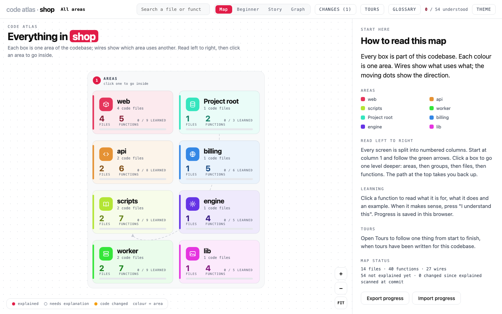
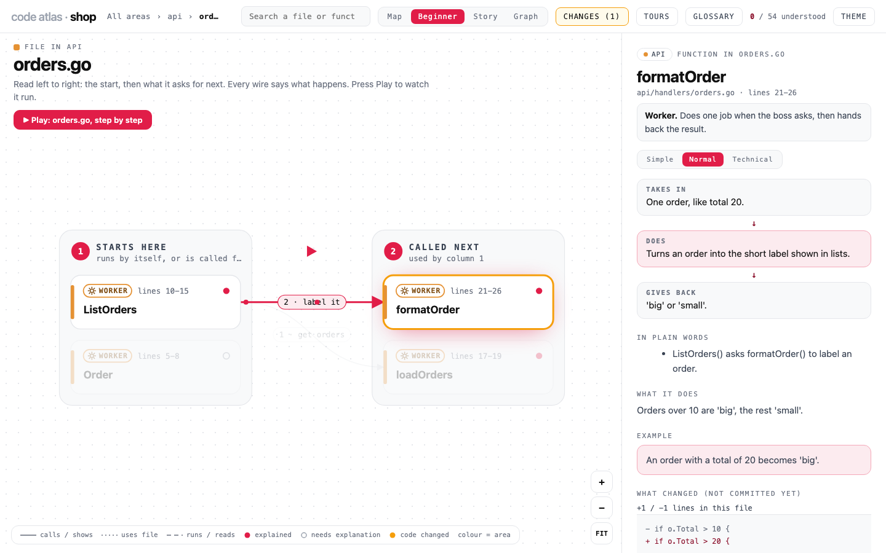
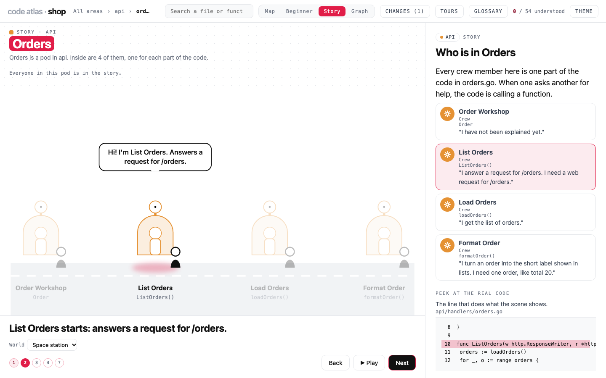
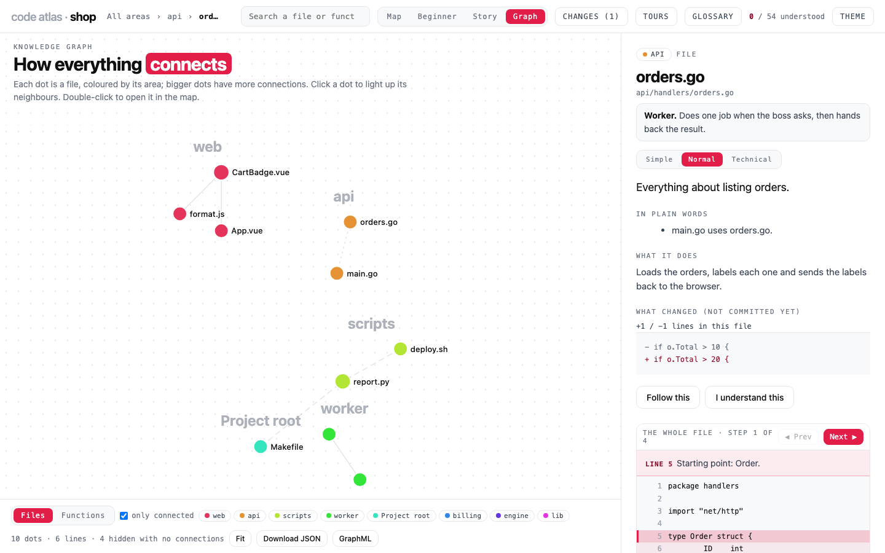

# Code Atlas

A Claude Code skill that turns any codebase, in any programming language, into a private website that explains how the code works. It shows a map you can zoom into, plain-English explanations of every part, the code itself, and a knowledge graph of how everything connects.

It is built for people learning a codebase: newcomers to a team, people who built something with AI and now want to understand it, or anyone coming back to old code.

| Map | Beginner |
|---|---|
|  |  |
| **Story** | **Graph** |
|  |  |

*Screenshots from the made-up demo project in [`demo/shop`](demo/shop).*

## What you get

Code Atlas creates one folder, `code-atlas/`, inside your project. Open `code-atlas/index.html` in a browser. It has four views:

- **Map:** areas of the codebase, then folders, files and functions. Click to zoom in; the camera glides in and out so you never lose your place. Wires show who calls whom.
- **Beginner:** every box gets a job (Boss, Worker, Helper, Ingredients, Decoration) and three panels: *Takes in → Does → Gives back*.
  - Wires carry short labels ("get orders", "label it").
  - **Play** steps through a file in the order the code runs.
  - **Follow this** shows one chain from start to finish.
  - Click any line in the code panel and the map points at the function it belongs to.
- **Story:** the code retold as a world you pick from a menu: a town, a restaurant, a space station, a school, or one you describe to Claude ("make it a cricket team"). Areas are neighbourhoods, files are buildings and functions are people. They talk in speech bubbles, pass real data in envelopes, and end each building with a short quiz.
- **Graph:** a knowledge graph of the whole project.
  - Every file or function is a dot coloured by its area; every connection is a line.
  - Click a dot to light up its neighbours.
  - Download the graph as JSON or GraphML for tools like Gephi, yEd or Cytoscape.

**Also included:**
- **Three explanation levels:** Simple (for kids and complete beginners), Normal, and Technical (for developers: signature, lines and connections).
- **What changed:** a Changes button outlines every file and function changed since the last commit, or not committed yet, and shows the changed lines. Handy right after an AI assistant edits your code.
- **Phones and tablets:** every view works on a small screen, with pinch to zoom and the details in a sheet under the map.
- Search, guided tours, a glossary of coding words, progress marks ("I understand this") and light and dark mode.
- An optional rescan after every commit, which flags new or changed code so the explanations can be refreshed.

## What you need

- **[Claude Code](https://claude.com/claude-code)**, in the terminal, desktop app or an IDE. The skill runs small scripts, so it needs an agent that can use a shell.
- **Node.js 18 or newer.**
- **git** (recommended). Used to list files and to keep the output folder out of your commits.
- **A web browser** to open the result. Chrome, Edge, Firefox and Safari all work. Nothing is loaded from the internet.

**Optional, and used automatically if present:**
- **Python 3:** exact reading of Python code.
- **The TypeScript compiler** (in your project's `node_modules` or installed globally): exact reading of JavaScript and TypeScript.
- **Playwright:** lets Claude open the finished page and check it for you.

## Install

**As a plugin (recommended).** In Claude Code:

```
/plugin marketplace add Mayur456/code-atlas
/plugin install code-atlas@code-atlas
```

**Or copy the skill folder.**
- For all your projects, copy [`plugins/code-atlas/skills/code-atlas`](plugins/code-atlas/skills/code-atlas) to `~/.claude/skills/code-atlas`.
- For one project only, copy it to `<project>/.claude/skills/code-atlas`.

## Use it

Open your project in Claude Code and ask in your own words, for example:

- "Help me understand this repo."
- "Make a code atlas of this project."
- "I'm new to this codebase. Explain it visually."
- "Show me how my code connects as a knowledge graph."

Claude will then:

1. Look around the project and set up `code-atlas/`.
2. **Ask which colours and which story world you want.** Colours default to your project's brand colours if it finds them in your CSS or theme files; you can choose a suggested palette or your own instead. The world defaults to a town.
3. Group the code into a handful of clear areas and scan it.
4. Write explanations, overview first: every area and file, then the entry points and busiest functions. Anything not yet explained is marked, and you can ask for any part later ("explain the billing area").
5. Add the beginner text, walkthroughs and an overview story, check the page, and offer the optional rescan after each commit.

A large codebase gets a working map in seconds. The explanations take longer, because Claude reads the code before writing them.

## Try it on the demo

[`demo/shop`](demo/shop) is a tiny, made-up online shop written in 11 languages (Go, Java, Rust, PHP, Ruby, Python, JavaScript, Vue, shell, Make and CSS). Copy it somewhere, open it in Claude Code and ask for a code atlas. Or run the scripts yourself:

```
cd demo/shop && git init
node ../../plugins/code-atlas/skills/code-atlas/scripts/init.mjs
node ../../plugins/code-atlas/skills/code-atlas/scripts/scan.mjs
open code-atlas/index.html
```

Without Claude you get the map, graph and stories, but no written explanations.

## What gets created

```
code-atlas/
  index.html        the website (open this)
  data.js           the scanned map
  config.json       areas, names, story world (edit by hand or ask Claude)
  theme.json        colours and fonts
  explain/*.json    the explanations Claude writes
  assets/           theme stylesheet and local copies of fonts
  graph.json        the knowledge graph (nodes + edges)
  graph.graphml     the same, for graph tools
```

## Privacy

- **Everything stays on your computer.** The scripts make no network requests, send no analytics, and the website loads nothing from the internet.
- **The output folder contains copies of your code**, so it is added to `.git/info/exclude` and never committed. Don't publish it or share it unless you mean to share that code.
- **Left out by default:**
  - `.env` files, keys, certificates, and file names containing "secret", "credential" or "password"
  - dependency folders (`node_modules`, `vendor`, virtual environments)
  - build output, lockfiles, minified and generated files, binaries, and files over 300 KB
- The skill tells Claude not to upload the output anywhere.

## Languages

It works on any text-based code without setup:

| How it reads | Languages |
|---|---|
| Braces | JavaScript / TypeScript, Go, Rust, Java, C#, C/C++, Kotlin, Swift, Scala, Dart, PHP, Groovy, R |
| Indentation and `end` keywords | Python, Ruby, Lua, Elixir |
| Script blocks and component tags | Vue, Svelte, Astro, HTML |
| Commands | Shell scripts, Makefiles, `package.json` scripts |
| File boxes only | Other files (SQL, CSS, config) |

**How it connects things:**
- Calls inside a file are matched by name.
- Calls across files are matched through imports, or, as a marked guess, by a function name that appears only once in the project.
- Code that loads things by a name built at run time is invisible to any scanner. Claude can add those connections by hand in `config.json`.

## Keeping it up to date

- **After code changes**, ask Claude to "refresh the code atlas". New functions are explained, and changed ones are re-read and rewritten.
- **Renamed functions** keep their explanations when their code did not change.
- **Optional auto-rescan:** `scripts/install-hook.mjs` adds a local git hook that rescans after every commit. It never blocks a commit and never replaces an existing hook.

## Settings

Claude edits these for you, but you can too. See [`references/config.md`](plugins/code-atlas/skills/code-atlas/references/config.md).
- **Areas:** names, colours, icons, and which folders belong to each.
- **The overview's left-to-right order.**
- **Story world** the page opens with (the reader can switch), or a custom one.
- **Explanation level** the page opens with.
- **Extra files** to include and folders to leave out.

## Limits

- **Approximate connections:** without a full compiler for every language, connections are found by reading the text. They are good for learning, not for refactoring decisions.
- **Explanations take reading time:** they are only as complete as you ask for. Big projects start with an overview and grow section by section.
- **Runtime:** the skill is made for Claude Code. It needs a shell, Node.js and a copy of the code on disk.

## Development

```
node tests/smoke.mjs            # scan the demo with the exact readers that are available
node tests/smoke.mjs --generic  # scan it with the plain-text reader only
```

The same tests run on GitHub for every push. Contributions are welcome: a new language reader, a better layout or a new story world.

## License

[MIT](LICENSE)
